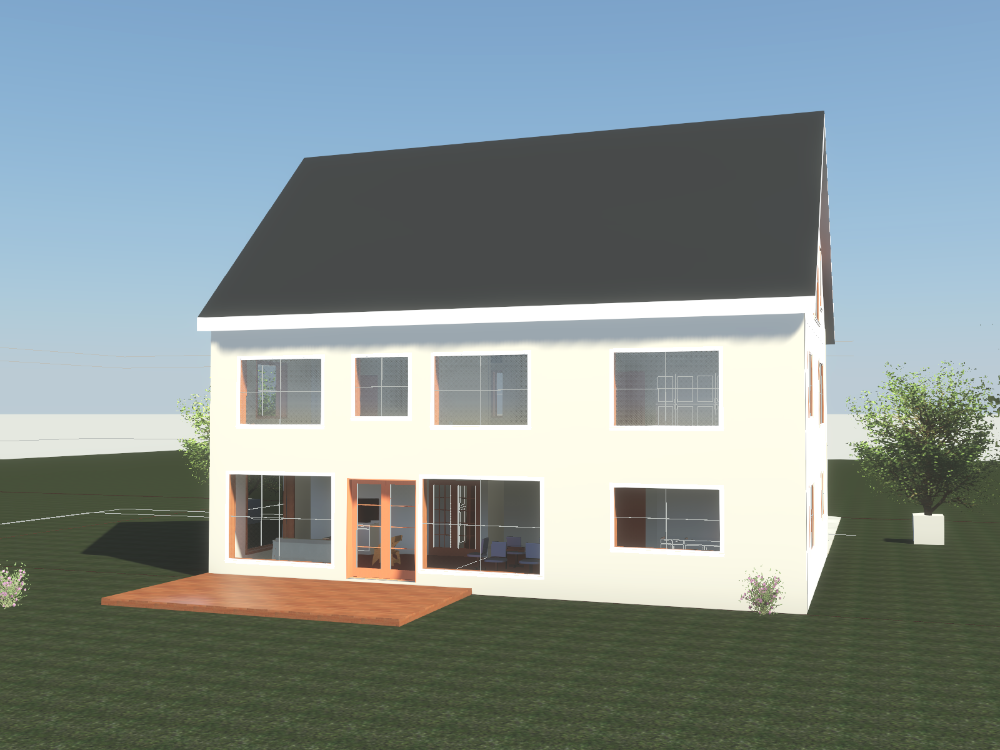

# RevitMCP

An MCP server and a Revit plugin that let Claude build models in Autodesk Revit, not just read them.



Claude designed this 300 m² cottage and built it in Revit through these tools: 40 walls, 20 doors, 29 windows, 26 rooms, two staircases, a roof, furniture and a garden. Its drawings and material choices are in [`designs/cottage`](designs/cottage).

The project is experimental. It has been built and tested on one machine, and there are no prebuilt releases, so you build it from source.

## Requirements

- Windows
- Autodesk Revit 2027 with your own licence, tested on 2027.3
- Revit's **Russian** content. The default project template and the family library are fixed paths under `C:\ProgramData\Autodesk\RVT 2027`, in `Templates\Russian` and `Libraries\Russian`. Without them `create_project` and `load_family` do not work. Revit's interface can be in English: only the content has to be Russian.
- .NET SDK 10.0.403 or a later 10.0.4xx
- Node.js 24 or newer
- An MCP client. The repository includes a `.mcp.json` for Claude Code.

## Install

Clone the repository and restore its locked dependencies:

```bash
git clone https://github.com/galamag/RevitMCP.git
cd RevitMCP
dotnet restore --locked-mode
cd src/server
npm ci
npm run build
cd ../..
```

Close Revit before the first install. If Revit or its add-in folder is somewhere else, set the `RevitInstallDir` and `RevitAddinsDir` environment variables now, because the next step reads them.

Build the plugin, copy it to your Revit add-in folder and start Revit:

```bash
powershell -NoProfile -ExecutionPolicy Bypass -File scripts/restart-revit.ps1
```

Revit asks whether to load the add-in. Choose **Always Load**. The script waits 120 seconds for the plugin, so if you answer later it prints `STOPPED`. That is not a failure: look at Revit, and do not run the script again.

Later runs update the plugin. If Revit is running, the script closes it only when every open document is saved in `%USERPROFILE%\Documents\RevitMCP`. Otherwise it stops and leaves Revit alone. It never kills the process.

Then open Claude Code in the repository root. `.mcp.json` starts the server from `src/server/dist/index.js`. In another MCP client, run `node src/server/dist/index.js` as a stdio server.

## Tools

The server exposes 35 tools. Lengths are in millimetres and angles in degrees.

| Area | Tools |
|---|---|
| Connection | `get_status`, `get_request_status`, `cancel_request` |
| Projects | `create_project`, `open_project`, `save_project`, `save_project_template` |
| Reading | `get_model_info`, `list_types`, `list_materials`, `get_elements`, `get_warnings`, `get_view_snapshot` |
| Types and materials | `create_type`, `create_materials` |
| Building | `create_levels`, `create_walls`, `create_floors`, `create_roof`, `create_ceilings`, `create_floor_openings`, `attach_walls`, `create_stairs`, `create_railings`, `create_ground` |
| Rooms | `create_rooms`, `create_room_separators` |
| Families | `load_family`, `place_instances`, `place_hosted` |
| Views | `create_3d_view` |
| Editing | `update_elements`, `delete_elements`, `undo_last_operation`, `get_last_undo_result` |

## How it works

```
Claude ⇄ MCP server (TypeScript) ⇄ local socket ⇄ plugin (C#, inside Revit) ⇄ Revit API
```

The Revit API can only be called from Revit's main thread, so the plugin queues each Revit command and runs it through `ExternalEvent`. Each operation runs in one transaction, so it can be reverted with Undo.

What keeps it contained:

- The plugin listens on `127.0.0.1` only, and every call needs a token from `%LOCALAPPDATA%\RevitMCP\connection.json`.
- There is no tool that runs arbitrary code.
- Projects can only be created and opened in `%USERPROFILE%\Documents\RevitMCP`.
- Families can only be loaded from Revit's library folder.

## Repository layout

| Path | Contents |
|---|---|
| `src/server` | The MCP server |
| `src/plugin` | The Revit plugin |
| `src/contract` | The contract between the server and the plugin |
| `tests` | .NET unit tests |
| `scripts` | Deploying the plugin and restarting Revit |
| `designs` | Buildings made with the tools, labelled in Russian |
| `.claude/agents` | The Claude agents that design, build and inspect a building, and those that develop this project |

`CLAUDE.md` holds the project rules and a long list of Revit API traps found along the way.

## Development

Run `dotnet` from the repository root and `npm` from `src/server`. The plugin references Revit's own DLLs, so building the solution needs Revit installed.

```bash
dotnet build RevitMCP.sln
```

```bash
dotnet test RevitMCP.sln
```

```bash
npm test
```

```bash
npm run test:live
```

`test:live` needs a running Revit with the plugin loaded. It creates projects in `%USERPROFILE%\Documents\RevitMCP` and leaves them open.

## License

[MIT](LICENSE).

RevitMCP is an independent project, not affiliated with or endorsed by Autodesk or Anthropic. Autodesk and Revit are trademarks of Autodesk, Inc. This repository contains no Autodesk files.
